<p align="center">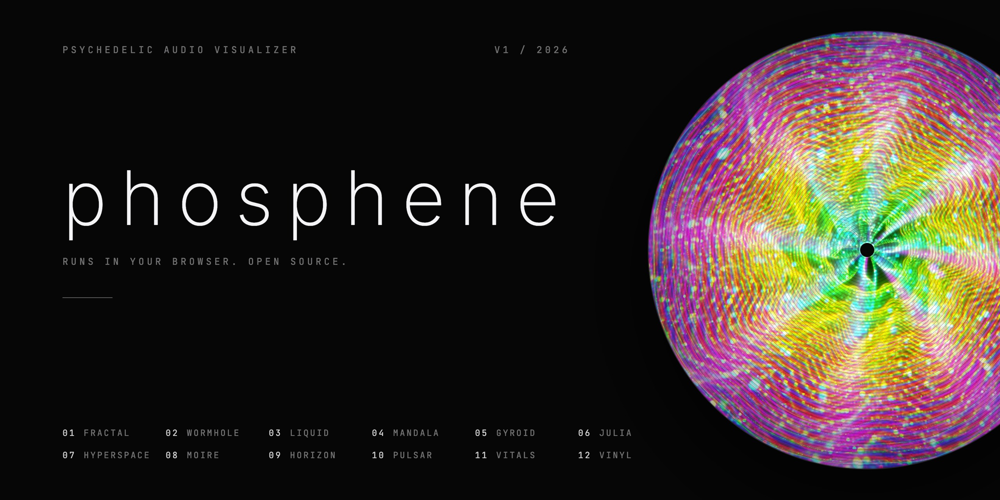</p>

# phosphene

A psychedelic audio visualizer that runs in your browser. Twelve GPU shader worlds (fractals, a wormhole, liquid light, a raymarched lattice, warp-speed stars, op-art, a synthwave horizon, a heart monitor, a spinning record and more) that move with whatever you are listening to: Spotify in a browser tab, YouTube, your microphone or a local file.

<p align="center"><b>Open it: <a href="https://phosphene-visualizer.vercel.app">phosphene-visualizer.vercel.app</a></b><br>Desktop Chrome, Edge or Arc for tab audio. Phones work with the mic.</p>

No install, no account, no build step. Everything runs on your device and no audio ever leaves the browser.

<table>
  <tr>
    <td width="50%">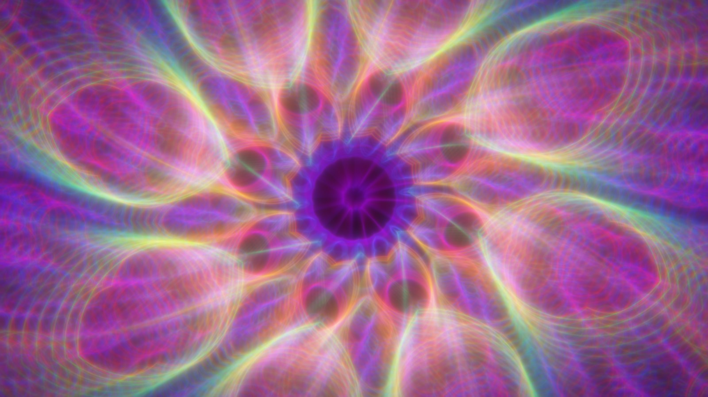</td>
    <td width="50%">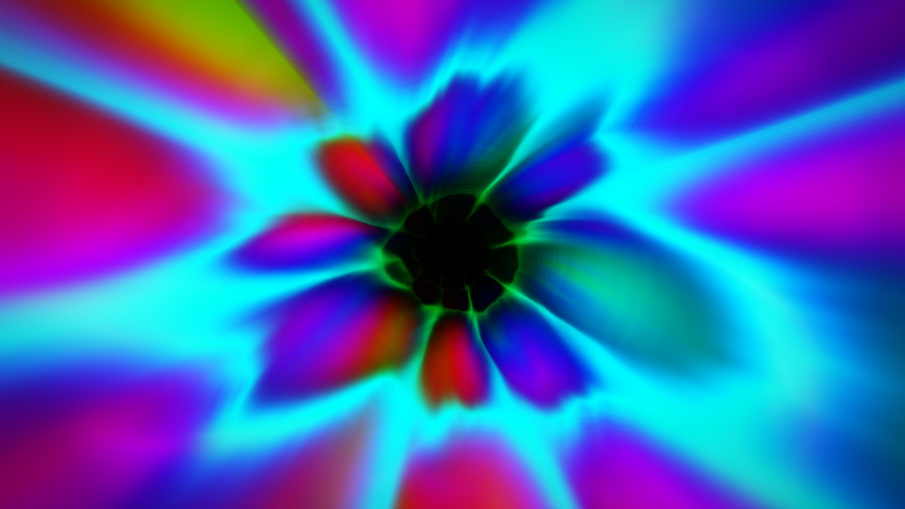</td>
  </tr>
  <tr>
    <td>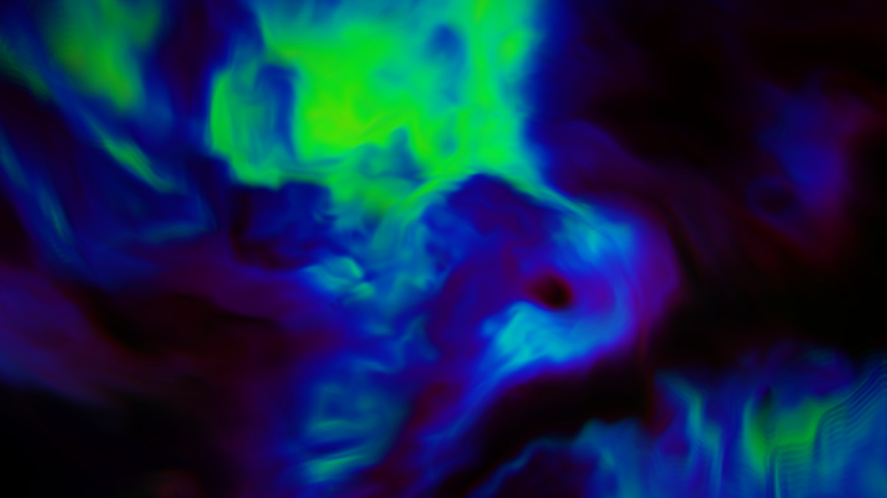</td>
    <td>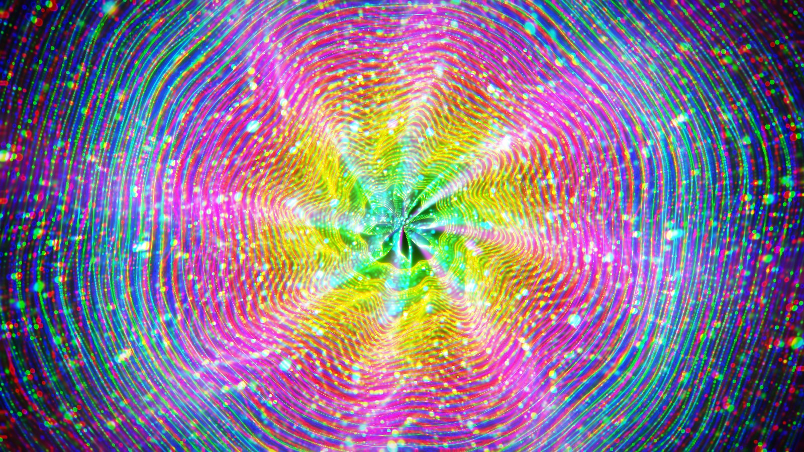</td>
  </tr>
  <tr>
    <td>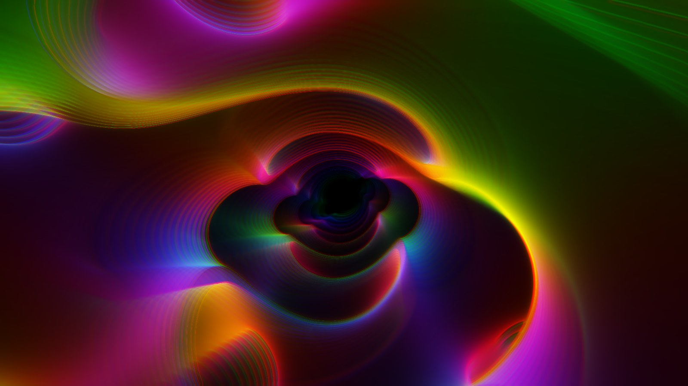</td>
    <td>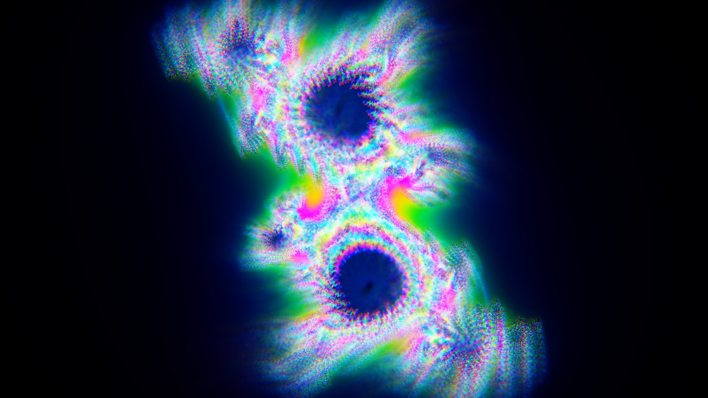</td>
  </tr>
  <tr>
    <td>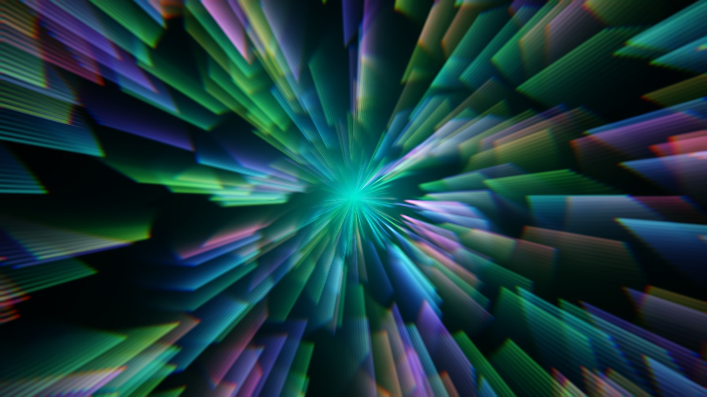</td>
    <td>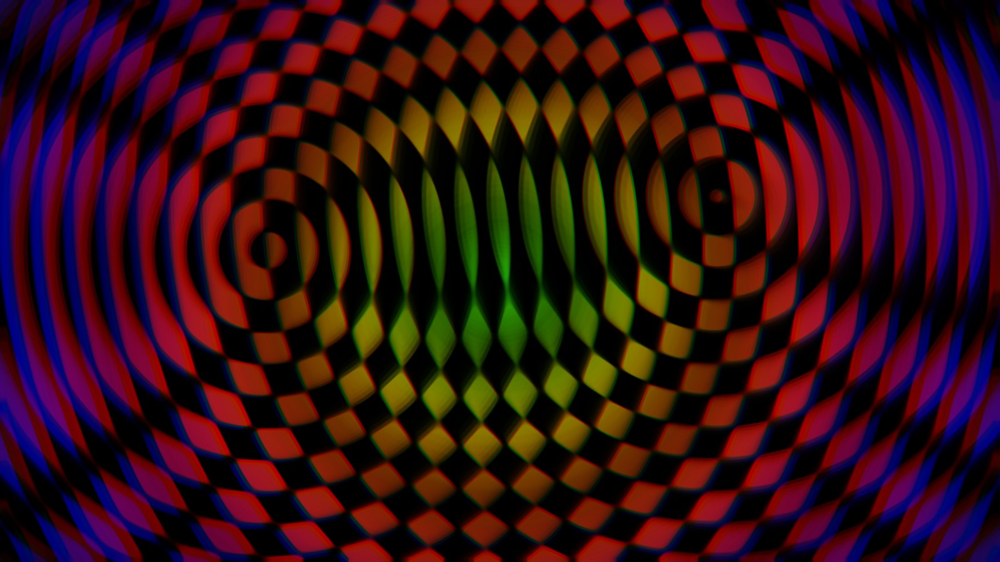</td>
  </tr>
  <tr>
    <td>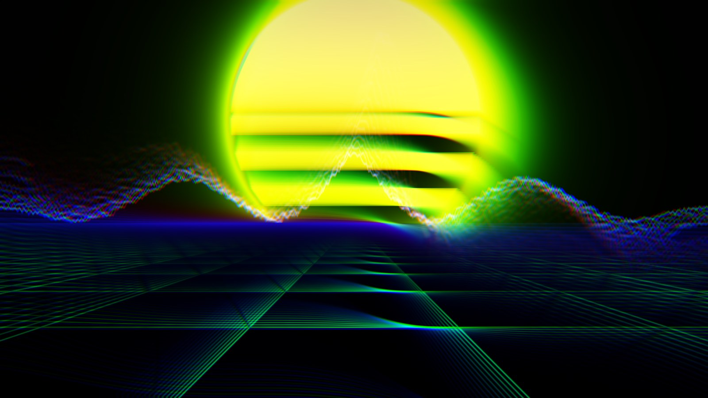</td>
    <td>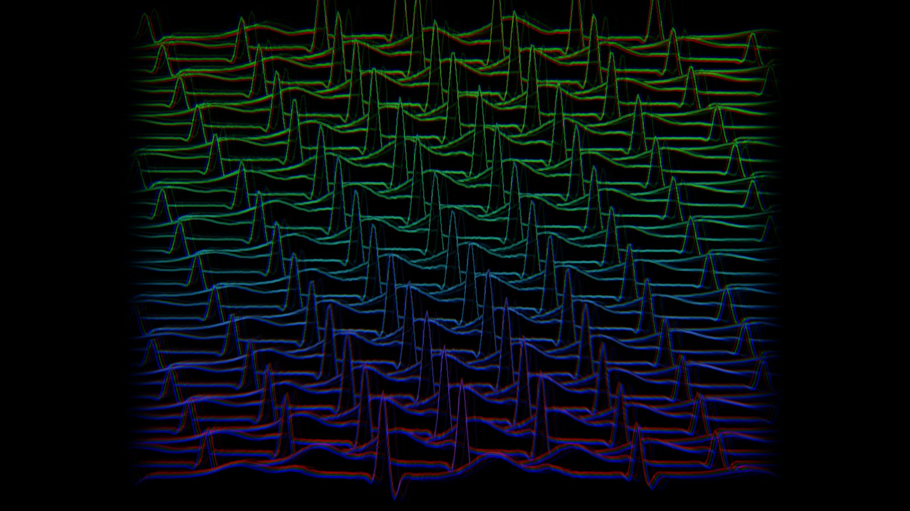</td>
  </tr>
  <tr>
    <td>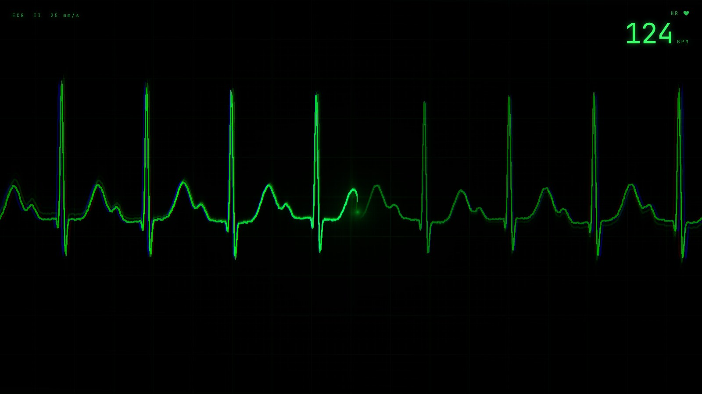</td>
    <td>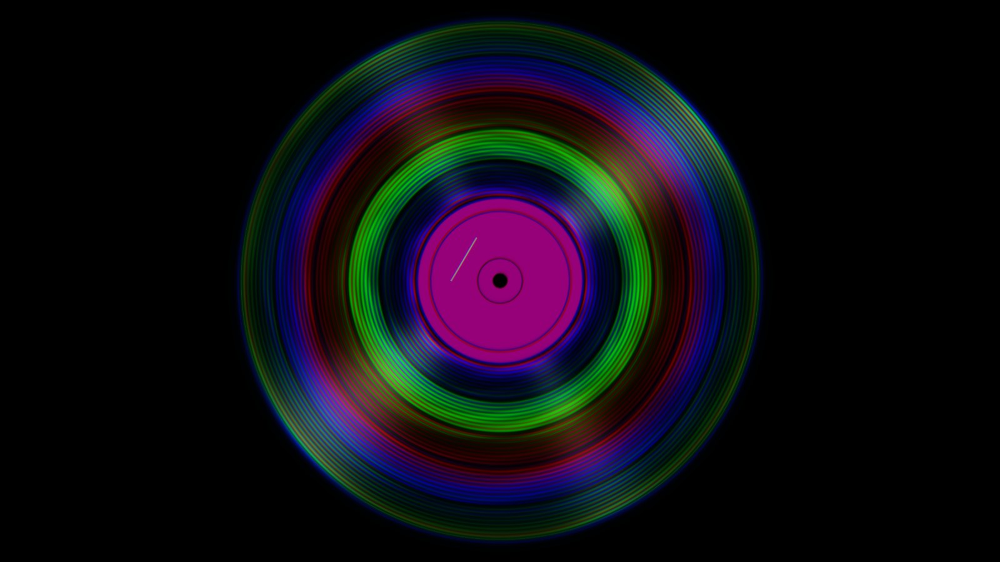</td>
  </tr>
</table>

## The scenes

| | Scene | What it is | What the music drives |
|---|---|---|---|
| 01 | Fractal Bloom | Kaleidoscopic iterated function system, folded into N-way symmetry | Ring radius per frequency band, zoom on the bass |
| 02 | Wormhole | Polar tunnel with noise-warped tiles | Flight speed on the bass, glowing seams on the kick |
| 03 | Liquid Dream | Three layers of domain-warped fractal noise | Flow offset on the bass, highlights on the highs |
| 04 | Spectral Mandala | Fourteen rings, one per frequency band | Each ring's wobble is its band's energy |
| 05 | Gyroid Flight | Raymarched gyroid lattice with a carved flight path | Wall thickness on the bass, glow along the spectrum |
| 06 | Julia Bloom | Julia set whose parameter traces the edge of the Mandelbrot cardioid | The mids push the shape, the bass breathes the zoom |
| 07 | Hyperspace | Three layers of star streaks in polar space | Warp speed and streak length on the bass |
| 08 | Moiré | Two drifting ring fields multiplied into op-art interference | Ring density on the mids, color on the highs |
| 09 | Neon Horizon | Perspective grid flyover, striped sun, spectrum skyline | The skyline is the spectrum, the sun pulses on the kick |
| 10 | Pulsar | 40 ridgelines with hidden-line removal, after the plot of pulsar CP 1919 made famous by *Unknown Pleasures* | Every kick is drawn as a heartbeat; each line is 0.15 s further in the past, so the rhythm cascades back |
| 11 | Vitals | A bedside heart monitor: green phosphor sweep, grid, erase gap and a live BPM readout | Each kick fires a PQRST complex; the BPM is measured from your music |
| 12 | Vinyl | A record spinning at 33 1/3, top down | Grooves light up by frequency from the label out, kicks nudge the platter |

Every scene draws into a feedback buffer. Each frame the previous image is zoomed, swirled and hue-shifted a little before the new one is laid on top, which is where the trails and the melting come from. Kicks punch the zoom and split the color channels.

## Using it

<table>
  <tr>
    <td width="50%">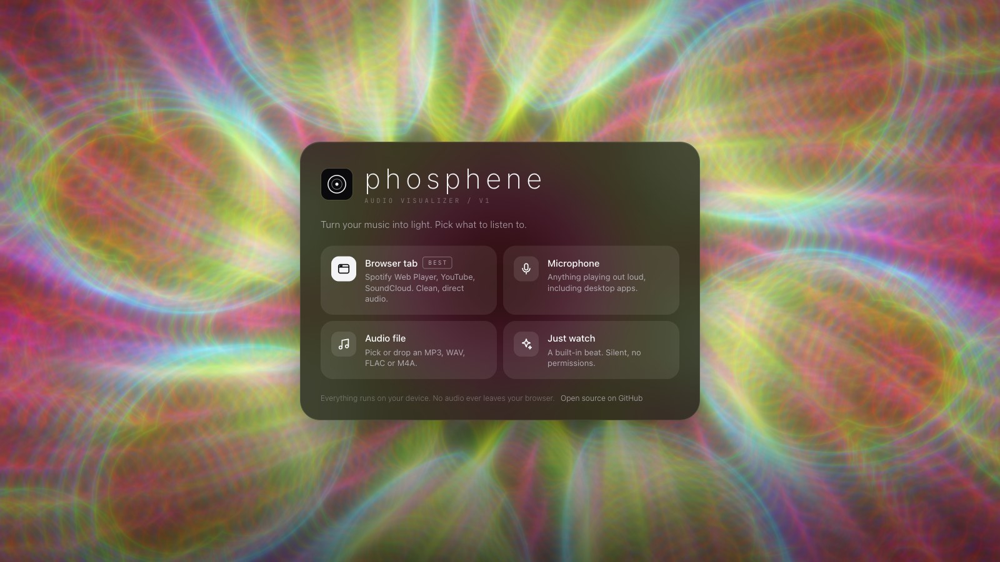</td>
    <td width="50%">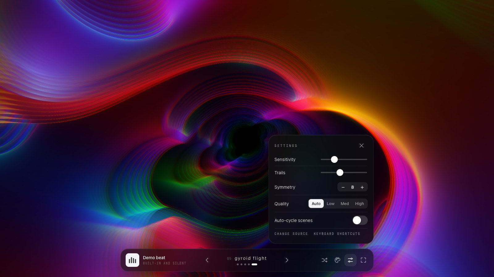</td>
  </tr>
  <tr>
    <td colspan="2">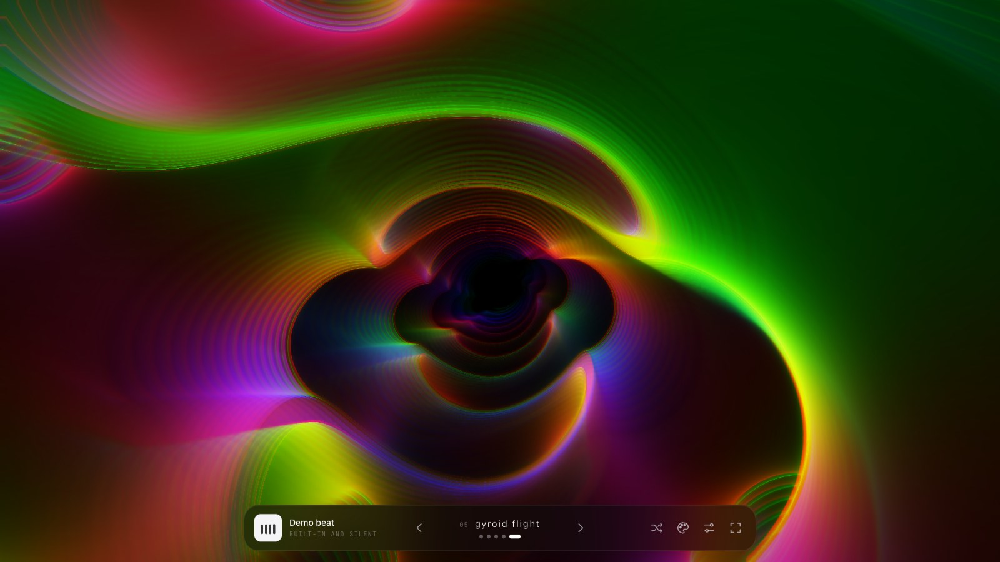</td>
  </tr>
</table>

Pick a source on the first screen:

- **Browser tab** (best). Play music in another tab (Spotify Web Player at open.spotify.com, YouTube, SoundCloud, Bandcamp), click Browser tab, choose that tab and turn on "Share tab audio". The visualizer gets the clean digital signal. Chrome, Edge and Arc on desktop. Safari cannot share tab audio.
- **Microphone**. Hears anything playing out loud, including the Spotify and Apple Music desktop apps. Works on phones.
- **Audio file**. Pick or drag in an MP3, WAV, FLAC or M4A. It plays through your speakers with a scrub bar.
- **Just watch**. A built-in silent beat, no permissions needed.

Keyboard: `1` to `9`, `0`, `-` and `=` jump to a scene (`0`, `-` and `=` are 10 to 12), `←` `→` or `Space` change scene, `A` toggles auto-cycle, `C` shifts the palette, `[` `]` change the symmetry, `↑` `↓` change sensitivity, `F` fullscreen, `H` hides everything, `?` lists all of this.

Touch: swipe sideways to change scenes, tap to show or hide the controls, double-tap for fullscreen where the browser allows it.

<p align="center">
  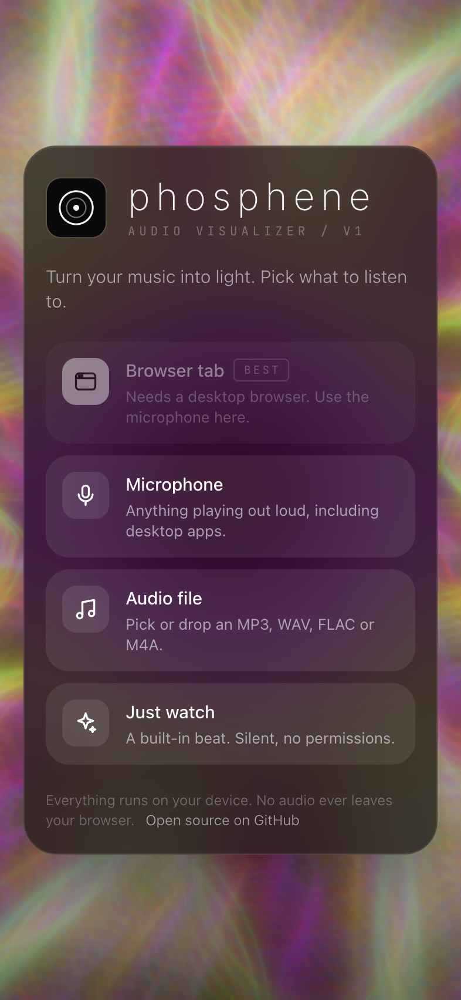
  &nbsp;
  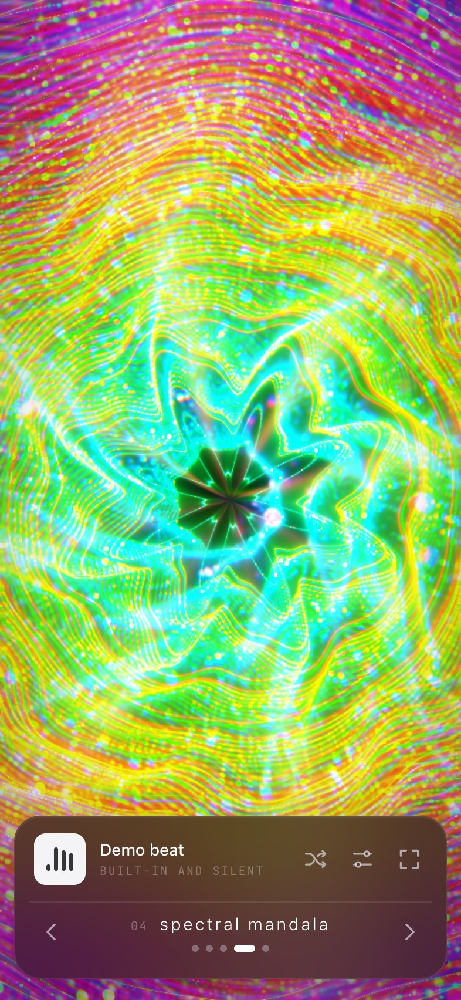
</p>

### URL options

Handy for streaming (OBS browser source), projectors and sharing a look:

| Parameter | Effect |
|---|---|
| `?scene=3` | Start on a scene (1 to 12) and skip the source picker |
| `?ui=0` | Clean output: no dock, no toasts, demo beat. Good for OBS |
| `?auto=0` | Stay on one scene |
| `?colors=0.45` | Fix the starting palette (0 to 1). Otherwise it is random each visit |
| `?demo` | Skip the source picker and start on the demo beat |

Example: `https://phosphene-visualizer.vercel.app/?scene=5&ui=0&auto=0`

## How it works

<p align="center">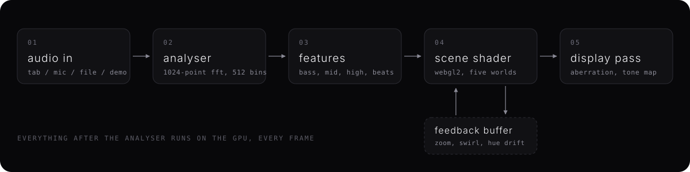</p>

- **Audio in.** Tab audio comes from `getDisplayMedia` (the video track is dropped right away), the mic from `getUserMedia` with echo cancellation, noise suppression and auto gain turned off so the music is not mangled. Files go through a `MediaElementSource`. Live sources are never connected to the speakers, so there is no feedback loop.
- **Analyser.** A Web Audio `AnalyserNode` with a 1024-point FFT gives 512 frequency bins per frame.
- **Features.** Bass, mid and high levels are averaged from bin ranges and auto-gained against a slowly decaying peak, so quiet and loud tracks both fill the screen. A beat is a bass spike well above its running average, with a short refractory window.
- **Scene shader.** One GLSL ES 3.00 fragment shader holds all twelve scenes. The 512 bins are uploaded each frame as a 512x1 texture so a shader can read any frequency directly. Feedback lives in two ping-ponged half-float render targets.
- **Heartbeat trace.** Pulsar and Vitals share a 256x64 half-float ring buffer (about 77 seconds at 213 samples per second). Every detected beat writes a PQRST complex (Q dip, R spike, S dip, T wave, and a P wave timed ahead of the next expected beat), and the BPM is the median of recent beat intervals.
- **Display pass.** Chromatic aberration that grows with the kick, exponential tone mapping, a saturation and contrast curve and a vignette.
- **Adaptive quality.** In Auto mode the renderer watches the frame time and steps the internal resolution down or back up, so phones stay smooth and do not cook.

No frameworks and no build. The whole app is `index.html` plus four small ES modules in `src/`.

## Run it locally

```sh
git clone https://github.com/maxsorto/phosphene.git
cd phosphene
python3 -m http.server 8765
```

Then open http://localhost:8765. It needs to be served (not opened as a file) because browsers only allow mic and tab capture on `localhost` or HTTPS. On a Mac you can also double-click `Launch Phosphene.command`, which does the same and opens Chrome.

Deploying is just static hosting. On Vercel: `vercel --prod` from the repo root, no settings needed.

## What's next

v1 (this) is browser only, which is why Spotify works through the Web Player and a shared tab. The desktop app can only be heard through the mic for now.

v2, the native Mac app:
- **Capture the Spotify and Apple Music desktop apps directly.** macOS can capture one app's audio without any driver: ScreenCaptureKit (macOS 13 and later) and Core Audio process taps (macOS 14.2 and later). No BlackHole, no changing your output device, no mic.
- **Now playing awareness.** Track title and artwork, with the palette pulled from the album cover.
- **Menu bar app with a borderless fullscreen window** for a second display or a projector.
- **Syphon and NDI output** so VJ tools (Resolume, VDMX, OBS) can take the visuals as a video source.

Also planned, for both versions:
- More scenes, and preset sharing by link
- Record a clip of what is on screen (canvas capture to video)
- MIDI and OSC control for live sets
- Beat tracking with tempo, so scene changes land on the phrase

Pull requests are welcome. A new scene is one function in `src/shaders.js` and one entry in the `SCENES` list.

## How long it took

Built in one Claude Code session. It started on 25 Oct 2026 at 17:47 local time with "find or make the coolest psychedelic audio visualizer i can use for my mac" and had reached the deployed, twelve-scene state described here by 18:31 the same evening: 44 minutes of wall-clock time, including the pauses for GitHub and Vercel sign-in.

Model: Claude Opus 5.5 in Claude Code. Measured from the session transcript when this section was written: 120 assistant turns, about 152,000 output tokens and about 240,000 tokens written to the prompt cache, plus roughly 19 million cached-read tokens (cheap re-reads of the same context).

## Repository layout

- `index.html` the app shell (welcome screen, dock, settings)
- `src/shaders.js` all GLSL: the twelve scenes, feedback and display passes
- `src/renderer.js` WebGL2 setup, feedback buffers, heartbeat texture, adaptive resolution
- `src/audio.js` sources, FFT analysis, levels and beat detection
- `src/ecg.js` the heartbeat waveform, its ring buffer and the BPM
- `src/main.js` UI, controls, gestures, URL options and the frame loop
- `src/styles.css` the interface
- `docs/` README images, the diagram and the cover art source (`docs/cover/cover.html`)

## License

MIT, see [LICENSE](LICENSE). Spotify, YouTube, SoundCloud and Apple Music are trademarks of their owners. This project is not affiliated with any of them; it only listens to audio your browser already plays.
